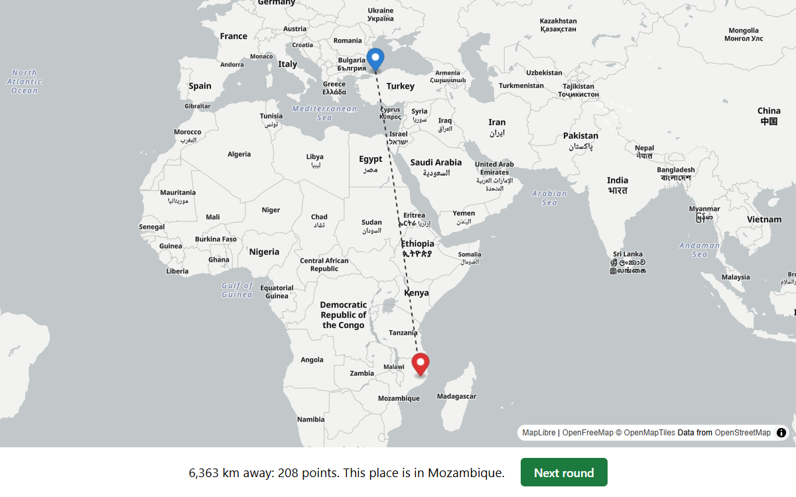

# Where in the World (v2)

A browser game: you see satellite imagery of a place where people live,
click on the map where you think it is, and score points by how close you
were. Five rounds per game, anywhere in the world.

Rebuild of [where-in-the-world](https://github.com/hurr-son/where-in-the-world);
see [docs/PROTOTYPE_PLAN.md](docs/PROTOTYPE_PLAN.md) for the plan and decisions.



## How to play

1. Press **Start**. You get satellite imagery of a random populated place.
   You can pan and zoom out a little (about 1 km).
2. Click the small map to place your guess (on a phone, tap it to open it
   first), then press **Guess** or Enter.
3. See how far off you were and which country it was. Press **Next round**
   or Space.
4. After five rounds you get your total, out of 25,000.

Each round scores `5000 × e^(−distance / 2000 km)`: 5,000 for a perfect
guess, about 1,840 at 2,000 km, about 410 at 5,000 km.

## How places are picked

Not uniformly from a list of towns (v1 did that and ended up mostly in
Russian villages). Instead, from a population grid:

1. A **country**, weighted by population^0.3, so big countries come up more
   often but small ones still appear (a "world tour").
2. A **~5 km grid cell** in that country, weighted by population^0.8, so
   denser places are more likely.
3. A random point inside the cell.

The grid is built once by a Python pipeline and shipped as
`public/data/grid.json` (688k cells in 196 countries, 1.1 MB gzipped).

## Development

Needs Node.js 22.

```bash
npm install
cp .env.example .env   # then put your Mapbox token in .env
npm run dev            # http://localhost:5173/where-in-the-world-v2/
npm test               # Vitest
npm run build          # type-check and build into dist/
```

The Mapbox token must be a **public** token (`pk.…`) with URL restrictions
for `localhost` and your Pages domain: anything sent to the browser is
visible to everyone, so the restriction is what protects it.

Game settings (rounds, zoom, scoring, sampling exponents, tile URLs) are in
[src/config.ts](src/config.ts).

## Rebuilding the locations

Needs Python 3.11. Settings are in [tools/grid.toml](tools/grid.toml).

```bash
uv venv .venv && uv pip install -r tools/requirements.txt   # or python -m venv + pip
.venv/bin/python tools/download_data.py   # ~500 MB into data/raw/ (gitignored)
.venv/bin/python tools/build_grid.py      # writes public/data/grid.json, prints a report
.venv/bin/python tools/grid_to_gpkg.py    # optional: cells as a GeoPackage for QGIS
.venv/bin/pytest tools/tests
```

`build_grid.py` sums the 1 km GHS-POP raster into 0.05° cells, assigns each
cell to a country, drops small cells and countries, and prints how many
rounds per 10,000 would land in each country, continent and cell size, so
the exponents can be tuned before playing. The output is byte-for-byte
reproducible.

## Deploying

[.github/workflows/deploy.yml](.github/workflows/deploy.yml) builds and
publishes to GitHub Pages on every push to `main`. One-time setup:

1. Settings → Pages → Source: **GitHub Actions**.
2. Settings → Secrets and variables → Actions → new repository secret
   `VITE_MAPBOX_TOKEN` with your public Mapbox token.
3. In your Mapbox account, add `https://hurr-son.github.io` to the token's
   URL restrictions.

## Data and licences

| What | Source | Licence / terms |
|---|---|---|
| Satellite imagery | [Mapbox Satellite](https://docs.mapbox.com/data/tilesets/reference/mapbox-satellite/) (© Mapbox, © Maxar) | [Mapbox terms](https://www.mapbox.com/legal/tos); logo and attribution shown on the map |
| Guess and result maps | [OpenFreeMap](https://openfreemap.org/), [OpenMapTiles](https://www.openmaptiles.org/), © [OpenStreetMap](https://www.openstreetmap.org/copyright) contributors | Free, no key; OSM data is ODbL |
| Population | [GHS-POP R2023A](https://human-settlement.emergency.copernicus.eu/), epoch 2025, 30″ (© European Union) | [CC BY 4.0](https://creativecommons.org/licenses/by/4.0/); summed into 0.05° cells |
| Country borders | [Natural Earth](https://www.naturalearthdata.com/) 1:10m admin-0 | Public domain |
| Map library | [MapLibre GL JS](https://maplibre.org/) | BSD-3-Clause |
